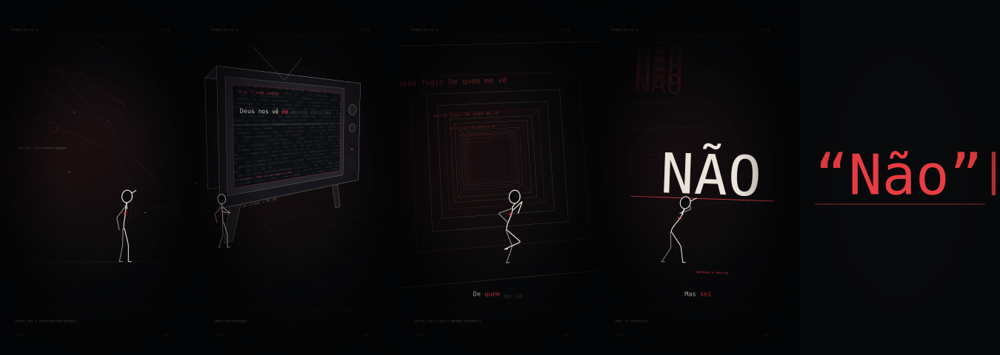

# Nocturne

**Videoclipes musicais animados, renderizados localmente em MP4.**



Nocturne transforma áudio, letra e um storyboard JSON em cenas com personagens articulados, palavras físicas, interfaces, câmera e ambientes com perspectiva 3D. O editor usa React e TypeScript; a prévia e a exportação executam o mesmo motor SVG calculado por tempo. Sharp rasteriza os quadros e FFmpeg produz H.264 com áudio AAC.

Esta é uma primeira implementação funcional. O planejamento automático utiliza um vocabulário multilíngue, expressões e metáforas editáveis; não é um modelo generativo capaz de inventar uma direção inédita para qualquer letra. A revisão artística e de sincronização continua importante.

## O que já funciona

- Importação de MP3, WAV e FLAC, edição da letra e importação/exportação de projetos JSON.
- Análise local de ataques, BPM provável, batidas, envelopes de energia, silêncios e mudanças prováveis de seção.
- Alinhamento por âncoras ASR com correspondência monotônica; trechos ausentes recebem interpolação explicitamente sinalizada.
- 20 famílias de cenas: constelação, coração, fuga, decisão, chamada, ocultação, alma, queda, negação, órbita, descanso, terminal, oceano, porta, elevação, televisão CRT, corredor 3D, espelho, tempestade e relógio.
- Personagens vetoriais com IK de dois segmentos, passadas com contato e velocidade contínuos, pés apoiados no chão, antecipação, respiração e mistura contínua entre ações.
- Andar, correr, tropeçar, cair, ajoelhar, levantar, rastejar, hesitar, reagir, segurar, empurrar, arrastar e descansar, além de virar, resistir ao vento, flutuar e recuar de um impacto.
- Televisão construída com vértices 3D, projeção perspectiva e palavras projetadas na superfície da tela. Chiado, varredura, antenas, botões, volume e movimento de câmera são procedurais.
- 17 transições com duração ligada ao BPM: corte, obturador, tinta, dissolução real, troca de canal, íris, whip pan, queima, mergulho, planos divididos, fragmentação, película vertical, onda circular, varredura CRT, diafragma, reescrita e travessia de profundidade.
- Zooms semânticos por palavra/frase: a câmera entra na letra ou na TV; o cenário e o personagem saem do quadro durante o close-up. Os eventos acompanham o `wordId` quando os tempos são editados.
- Frases inteiras em um plano com perspectiva, rotação 3D sutil e enquadramento protegido nos formatos vertical e horizontal. Gritos têm ataque rápido e recuperação; trechos suaves, crescendos e notas sustentadas recebem envelopes distintos.
- Direção expressiva: 36 receitas de câmera, 48 gestos, 20 tratamentos tipográficos com cinco faces DejaVu, 43 texturas e seis ritmos. O produto desses eixos oferece **8.916.480 combinações de presets**, geradas por seed e editáveis; não são milhões de animações desenhadas individualmente.
- O corpo interpreta dúvida, recusa, súplica, escuta, proteção e outras intenções com preparação e mistura entre frases. Gestos usam o tronco superior e preservam pés e mãos que sustentam objetos; não são ciclos de dança.
- Seis estilos e 14 filtros combináveis: noir, giz, sinal, corrupção digital, industrial ácido e esmeralda. Camadas têm intensidade, ordem e ativação próprias.
- Vocabulário narrativo em português, inglês, espanhol, japonês, coreano, russo, francês, alemão, italiano e chinês, com evidência das palavras reconhecidas no Inspector.
- PWA estático para GitHub Pages: importação, análise STFT em worker, edição e MP4 H.264/AAC no navegador com WebCodecs. Arquivos de áudio ficam no IndexedDB do aparelho.
- Editor com monitor, linha do tempo, envelope sonoro, cenas, palavras, câmera, personagem, estilos, desfazer e exportação com progresso.
- MP4 H.264 em 1080 × 1920 ou 1920 × 1080, a 30 ou 60 FPS, com áudio sincronizado.
- Adaptador de composição para Remotion, opcional. O renderizador principal não depende do navegador nem de uma licença paga do Remotion.

## Requisitos

Node.js 22.12 ou superior, Python 3.10 ou superior, FFmpeg e FFprobe disponíveis no PATH. Use um computador para renderizar; a interface é responsiva, mas o servidor e o encoder são processos locais.

Instale FFmpeg com suporte a `libx264` no seu sistema. Em algumas distribuições essa compilação vem de um repositório multimídia. Os testes verificam a exportação real e falham se o encoder estiver ausente.

## Instalação e editor

```bash
git clone https://github.com/Kelvin-Marques-Cyber/Nocturne.git
cd Nocturne
npm ci
python3 -m venv .venv
source .venv/bin/activate
python -m pip install -r requirements.txt
npm run dev
```

Abra `http://localhost:4173`. Em **Fonte**, importe sua música. Em **Letra**, cole o texto e gere o storyboard. A sincronização pela voz inicia automaticamente na importação. Para refazer um projeto já aberto, use Letra → Sincronizar letra pela voz; trechos sem âncoras confiáveis continuam marcados para revisão.

O repositório contém a letra, o storyboard e a análise de “Deus nos vê”, usados na primeira entrega. A gravação pessoal e o vídeo de referência não são redistribuídos no código. Para reproduzir o storyboard original com a música original, copie seu MP3 para o caminho esperado:

```bash
cp "/caminho/Deus nos vê.mp3" public/media/deus-nos-ve.mp3
```

`git clone` baixa o código; `cd` entra na pasta; `npm ci` instala as versões do lockfile; `python3 -m venv` cria um ambiente isolado; `source` ativa esse ambiente; `python -m pip install -r` instala a lista indicada; `npm run dev` inicia o editor. O comando `cp` copia a gravação para o nome utilizado pelo exemplo.

No Windows, ative o ambiente com `.venv\Scripts\Activate.ps1` no PowerShell. Se o servidor usar outro Python, defina a variável `PYTHON` com o executável do ambiente virtual antes de iniciá-lo.

## Gerar um projeto com outra música

Salve a letra em UTF-8, com linhas vazias separando estrofes:

```bash
npm run project -- \
  --audio "/caminho/musica.flac" \
  --lyrics "/caminho/letra.txt" \
  --title "Minha música" \
  --artist "Meu nome" \
  --out projects/minha-musica.json
```

| Parâmetro | Significado |
| --- | --- |
| `--` depois de `npm run project` | Encaminha os argumentos seguintes ao script. |
| `--audio` | Arquivo sonoro original. É copiado para `public/media`. |
| `--lyrics` | Texto autoritativo da letra; a transcrição não o substitui. |
| `--title` / `--artist` | Título e autoria exibidos no filme. |
| `--out` | Caminho do projeto JSON gerado. |
| `--analysis` | Reutiliza uma análise JSON em vez de analisar novamente. |
| `--transcript` | Usa uma transcrição local que contenha tempos por palavra. |
| `--language` | `auto`, `pt`, `en`, `es`, `ja`, `ko`, `ru`, `fr`, `de`, `it` ou `zh`; orienta ASR e vocabulário. |
| `--transcribe` | Executa o ASR opcional antes do alinhamento. |
| `--reference` | Analisa tecnicamente um vídeo de referência e anexa os dados ao projeto. |

### Transcrição local opcional

```bash
python -m pip install -r requirements-asr.txt
python scripts/transcribe.py "/caminho/musica.mp3" --out projects/asr.json --model small --language pt
npm run project -- --audio "/caminho/musica.mp3" --lyrics letra.txt --transcript projects/asr.json --out projects/novo.json
```

`--model small` usa o modelo multilíngue pequeno; o primeiro uso baixa os pesos. Depois de armazenados, o processamento é local. `--model /pasta/do/modelo` permite usar pesos já disponíveis sem download. `--language pt` indica português; `--language auto` detecta o idioma no ASR. No editor, escolha o idioma antes de gerar o storyboard ou deixe Automático. Japonês e chinês usam `Intl.Segmenter`; coreano mantém os espaços e reconhece os radicais cadastrados.

Para japonês, coreano ou chinês, `npm run fonts` prepara uma vez a fonte Noto CJK, com checksum e licença OFL. A preparação local ocorre automaticamente quando um projeto CJK é criado/renderizado. No PWA, a primeira utilização baixa e guarda a fonte no aparelho. Depois, ela funciona offline.

O JSON ASR segue `{ "segments": [{ "start": 1, "end": 3, "text": "...", "words": [{ "text": "palavra", "start": 1.2, "end": 1.7, "confidence": 0.9 }] }] }`. Também pode ser importado na aba Letra.

**Alinhamento não é reconhecimento infalível.** No exemplo, 238 de 248 palavras possuem âncoras reconhecidas; dez são interpoladas. Palavras parecidas podem aproveitar tempos reconhecidos com confiança reduzida. O método não é alinhamento fonético forçado. O editor mantém `source` e `confidence` por palavra e oferece ajuste de início e fim.

## Renderizar

Música inteira, vertical, 30 FPS:

```bash
npm run render -- --project projects/deus-nos-ve.json --out output/deus-nos-ve.mp4
```

Horizontal, 60 FPS:

```bash
npm run render -- --project projects/minha-musica.json --format horizontal --fps 60 --out output/minha-musica-horizontal.mp4
```

Um trecho para revisão:

```bash
npm run render -- --project projects/deus-nos-ve.json --from 14 --duration 20 --out output/revisao.mp4
```

| Parâmetro | Significado |
| --- | --- |
| `--project` | Storyboard a executar. |
| `--out` | MP4 de saída; a pasta é criada automaticamente. |
| `--format vertical` | Composição nativa de 1080 × 1920. |
| `--format horizontal` | Composição nativa de 1920 × 1080; posições são recalculadas. |
| `--fps 30` / `--fps 60` | Taxa de quadros. |
| `--from` | Início do trecho, em segundos. |
| `--duration` | Comprimento do trecho; omitido, preserva a duração restante da faixa. |
| `--width` / `--height` | Resolução de teste; números pares até 3840. O formato do projeto ainda define o enquadramento. |
| `--preset` | Preset do x264; `fast` é o padrão, `ultrafast` serve para revisões. |

O áudio é decodificado sem a capa incorporada ao MP3. A duração do exemplo é 200,875828 s de amostras de áudio; pequenas diferenças para a duração de contêiner do MP3 vêm de cabeçalhos e padding. A exportação preserva o áudio decodificado e limita o vídeo à duração correspondente, dentro da grade de frames.

## Usar o editor

1. Importe áudio e letra. O botão Gerar storyboard substitui o planejamento atual; Desfazer recupera o estado anterior da sessão.
2. Clique em uma cena ou na linha do tempo. Use Espaço para reproduzir e setas para avançar ou recuar um quadro; Shift + seta move um segundo.
3. Escolha o estilo no monitor. No Inspector, ajuste metáfora, ação, transição, câmera e ponto de interesse. Em Filtros em camadas, adicione, ligue/desligue, reordene e ajuste cada efeito.
4. Use Zoom na letra para controlar a intensidade por cena. Focar palavra selecionada cria um close-up manual; Planejar zooms da música refaz os eventos automáticos.
5. Clique em uma palavra e ajuste `in` e `out`. Eventos que referenciam essa palavra acompanham sua alteração.
6. Salve o JSON. O navegador também guarda um rascunho local; o arquivo baixado e sua música são o conjunto portátil do projeto.
7. Exporte toda a faixa, a cena selecionada ou 15 segundos a partir do cursor. O botão Baixar MP4 aparece quando o encoder termina.

### Frases, gritos e interpretação vocal

Em **Direção expressiva**, use **Automatizar direção da música** para planejar câmera, gestos, tipografia e texturas. **Nova combinação** muda a variação mantendo os eventos manuais. Todos os controles participam do Desfazer e são salvos no JSON.

Selecione uma palavra e use **Focar frase selecionada**. O seletor **Entonação / interpretação** oferece Automática, Natural, Grito / ênfase forte, Suave / íntima, Crescendo e Nota sustentada. Assim, “Eu não sei” pode ganhar uma aproximação rápida quando gritado e um movimento mais contido quando cantado suavemente. Selecionar uma interpretação cria uma correção manual ancorada à frase.

A análise nova guarda energia na faixa de 120–3500 Hz, presença espectral, altura provável e periodicidade na mesma grade temporal do áudio. A decisão usa as janelas ocupadas pela letra e a intensidade relativa da gravação; letras maiúsculas ou uma batida forte, sozinhas, não identificam grito. O Inspector apresenta origem e confiança.

Os acentos de batida combinam a energia geral com graves e agudos no instante do ataque. Batidas fortes e fracas produzem respostas diferentes; uma marca estimada da grade em um trecho silencioso não aciona o efeito. A entrada do pulso é suavizada para evitar saltos bruscos da câmera.

**Essa leitura é uma estimativa da mistura musical.** Guitarras, coros, compressão e percussão podem interferir. Não há separação automática de voz nem um classificador treinado de emoções. Revise os resultados e use a correção manual quando necessário. O exemplo e projetos antigos continuam abrindo; reimporte a gravação para obter os novos contornos vocais, pois a análise antiga não contém esses dados e a música pessoal não é distribuída.

As cinco faces latinas acompanham o PWA e o renderizador local. A primeira preparação de CJK mantém o fluxo opcional já documentado. `node --import tsx scripts/prepare-film-fonts.ts` regenera as métricas das faces distribuídas.

Áudios importados, rascunhos, renders e dependências estão no `.gitignore`. O servidor foi construído como ferramenta local, sem contas, autenticação, fila distribuída ou hospedagem multiusuário. Não o exponha como serviço público sem implementar essa camada.

## JSON e módulos

O projeto possui `schemaVersion`, `seed`, `duration`, `audio`, `lyrics`, `analysis`, `words`, `scenes`, `character`, `style` e `alignment`. Todos os tempos são segundos absolutos na faixa original. As cenas cobrem a música sem lacunas nem sobreposições. Referências por `wordId` unem ação e letra.

| Caminho | Responsabilidade |
| --- | --- |
| `src/engine/model.ts` | Contratos JSON, estilos e validação. |
| `src/engine/math.ts` | Interpolação, easing, amostragem, ruído com seed e IK. |
| `src/engine/language.ts` / `semantics.ts` | Segmentação Unicode, medidas de texto, vocabulário e conceitos multilíngues. |
| `src/engine/focus.ts` | Seleção, envelopes e enquadramento dos close-ups tipográficos. |
| `src/engine/voice.ts` | Expressão vocal estimada por frase, picos e correções manuais. |
| `src/engine/catalog.ts` / `director.ts` | Catálogos combináveis e seleção narrativa determinística. |
| `src/engine/expression.ts` / `typography.ts` | Gestos contínuos e métricas das faces tipográficas. |
| `src/engine/transitions.ts` / `effects.ts` | Composição entre planos e pilha de filtros determinísticos. |
| `src/browser/` | Análise em worker, IndexedDB, contornos das fontes e MP4 com WebCodecs/AAC WASM. |
| `src/engine/rig.ts` | Corpo, poses e mistura entre movimentos. |
| `src/engine/frame.ts` | Direção por tempo, cenas SVG, palavras, câmera e efeitos. |
| `src/engine/space3d.ts` | Projeção perspectiva, TV, textos na tela e corredor profundo. |
| `src/engine/alignment.ts` | Correspondência monotônica entre letra e ASR, com interpolação declarada. |
| `src/engine/storyboard.ts` | Metáforas e montagem com planos de durações diferentes. |
| `src/editor` | Interface React. |
| `server/index.ts` | Importação, análise, salvamento e fila local de renderização. |
| `scripts/analyze.py` | Análise espectral do áudio. |
| `scripts/renderer.ts` | Rasterização e codificação por FFmpeg. |
| `src/remotion` | Adaptador opcional para Studio/Remotion. |
| `docs/reference-analysis.md` | Leitura editorial do vídeo de referência. |

Veja [o formato do storyboard](docs/storyboard.md) para criar cenas manualmente ou integrar outro planejador.

## Verificação

```bash
npm test
npm run build
npm run verify -- --project projects/deus-nos-ve.json --video output/deus-nos-ve.mp4
```

Os testes de mídia criam seu próprio som de teste; a gravação pessoal não é necessária para executar a suíte. São verificados IK, continuidade, escolha de cenas e palavras nos limites exatos, reprodução determinística do SVG, preservação da letra, âncoras ASR, rejeição de intervalos inválidos, perspectiva 3D, transições rasterizadas e exportação real H.264/AAC em 30/60 FPS. Um trem de pulsos sintético verifica ataques e BPM conhecido.

`verify` compara formato, resolução, taxa, quantidade de quadros, duração e início das trilhas de áudio/vídeo. Também verifica o conteúdo do áudio em três pontos por correlação, admite a quantização de até um frame no final da faixa e registra hashes dos SVGs amostrados por cena em `output/verification.json`.

## Remotion opcional

```bash
npm run remotion:studio
```

A composição `Nocturne` lê `public/demo.json`. Ela chama o mesmo `renderFrame(project, frame)` e adiciona o áudio. Para usar outro projeto, substitua esse JSON e mantenha o caminho do áudio dentro de `public/media`.

Remotion possui termos próprios, inclusive regras para organizações maiores. Consulte sua [licença](https://www.remotion.dev/docs/license). O fluxo padrão `npm run render` usa Sharp + FFmpeg e funciona sem Remotion Studio, serviços pagos ou um navegador instalado.

## Limites desta versão

- A análise de voz sem ASR é apenas uma hipótese espectral. Coro, reverb e voz cantada podem reduzir a precisão dos tempos reconhecidos.
- BPM pode ser identificado em metade ou dobro do andamento percebido. Batidas estimadas e ataques detectados são mantidos separadamente.
- A direção automática seleciona uma gramática de cenas implementada, não desenha qualquer objeto livremente descrito em linguagem natural.
- Interações com objetos são encenadas por constraints e poses; não existe um simulador físico completo.
- O 3D é geometria procedural projetada em SVG. Não há importação de modelos GLB, luzes físicas ou um editor 3D de uso geral.
- O mesmo tempo produz a mesma geometria, câmera e ruído. Rasterizadores de navegadores e sistemas podem apresentar diferenças de antialiasing; não se promete igualdade de pixels entre renderizadores diferentes.
- Um vídeo de referência pode ter suas propriedades técnicas extraídas. A análise artística aprofundada da referência desta entrega está documentada; o programa não entende autonomamente qualquer vídeo.

## Licença e autoria

Código original: **Copyright 2026 Kelvin e Silva Marques**, sob a **Apache License, Version 2.0**. Veja [LICENSE](LICENSE), [NOTICE](NOTICE) e [THIRD_PARTY_NOTICES.md](THIRD_PARTY_NOTICES.md).

A licença do código não transfere os direitos da música, da letra, do vídeo de referência nem das dependências.

## PWA e branch gh-pages

O mesmo editor tem dois modos. O servidor local usa Python e FFmpeg. O build do Pages executa importação, análise, prévia e exportação no aparelho, sem rotas `/api` nem envio da música para um servidor. O código-fonte fica em `main`; a branch `gh-pages` contém apenas os arquivos publicados.

```bash
npm run build:pages
npm run preview:pages
```

`build:pages` gera `dist` para `/Nocturne/`, injeta o cache versionado do service worker e inclui manifesto, ícones e licenças. A lista de arquivos de publicação é explícita: gravações pessoais, referências e rascunhos ficam fora do build. `preview:pages` serve o build para revisão. `NOCTURNE_BASE=/ npm run build:pages` gera para a raiz de um domínio; a base termina em `/`.

Para publicar com suas credenciais Git habituais:

```bash
npm run deploy
```

Esse comando compila, cria um checkout temporário, preserva o histórico existente de `gh-pages` e faz push normal, rejeitando alterações concorrentes. No GitHub, em **Settings → Pages → Build and deployment**, selecione **Deploy from a branch → gh-pages → / (root)**. Não exige GitHub Actions.

Abra o endereço HTTPS publicado e use Instalar app quando o navegador oferecer a opção; no iPhone, use Compartilhar → Adicionar à Tela de Início. O shell é guardado após o primeiro acesso; músicas importadas ficam no IndexedDB. Quando uma nova versão estiver pronta, o botão **Atualizar app** salva imediatamente o projeto e recarrega o aplicativo. Ele fica indisponível durante análise ou exportação. Uma geração anterior do cache é preservada para outras abas abertas; a versão ativa tem prioridade para os arquivos atuais e a navegação offline. Salve o JSON como cópia portátil; apagar dados do site remove os arquivos locais.

A exportação no PWA precisa de um navegador com encoder WebCodecs H.264 disponível. O áudio AAC tem fallback WASM local. A aplicação verifica o suporte e informa quando é necessário usar Chrome/Edge compatível ou o renderizador FFmpeg. Uma prévia HTTP em host não confiável não oferece instalação nem WebCodecs; GitHub Pages usa HTTPS. A duração segue os samples de áudio e os timestamps de cada frame, sem captura da tela em tempo real.

O planejamento aceita qualquer letra, mas o reconhecimento semântico cobre os conceitos cadastrados nos dez idiomas. Expressões desconhecidas recebem direção alternativa editável. O PWA tenta obter âncoras de voz automaticamente. Palavras sem evidência suficiente continuam interpoladas, sinalizadas e ajustáveis.

### Palco e edição no celular

O catálogo agora oferece 31 cenários, incluindo guitarra, piano e bateria com mãos articuladas e resposta à energia das batidas. Ponte, floresta, cidade, deserto, escadaria, gaiola, eclipse e prisma ampliam as metáforas da letra. Há 26 filtros em camadas, 13 faces tipográficas offline, 52 tratamentos de fonte, 80 gestos expressivos, 48 movimentos de câmera e oito acentos visuais de batida. São receitas combináveis; não clipes prontos de todas as músicas. A escolha de instrumentos usa palavras explícitas da letra ou o seletor da cena, sem prometer reconhecimento de instrumentos no áudio.

Notas prolongadas recebem extensão, contornos em rastro e um traço oscilante durante o intervalo da palavra. A grafia comum também funciona com duração e presença vocal; letras repetidas, como uma vogal estendida, são uma indicação adicional. Os tempos estimados limitam a precisão dessa reação e podem ser corrigidos no editor.

Colar ou editar a letra atualiza palavras, cenas e direção após uma breve pausa. Títulos antes da primeira seção e indicações entre colchetes não são tratados como canto. A sincronização sem transcrição continua estimada pelo áudio. A cena e as palavras acompanham a navegação na faixa. No celular, Prévia, Cenas, Letra, Áudio e Ajustes têm áreas próprias, com campos legíveis, controles para toque e rolagem disponível com o teclado aberto.

### Ritmo dos zooms

Os close-ups automáticos deixam pelo menos seis segundos de palco livre entre os destaques. Frases comuns e canto suave não acionam zoom por si só. Gritos, crescendos claros, notas prolongadas com tempos confiáveis e algumas palavras de forte ênfase podem gerar aproximações curtas. Um timestamp estimado muito longo não mantém a tela presa na letra. Projetos salvos recebem esse planejamento uma vez ao carregar, preservando letra, tempos, cenas, estilo e interpretações escolhidas manualmente.

## Biblioteca ampliada de cenas

351 opções selecionáveis: as 31 cenas originais e 320 composições procedurais em 40 novas famílias. Abismo, vale, farol, casa, mesa, jardim, trem, cartas, fotografia, fogo, mãos e outros mundos possuem geometria própria, com composições de noite, chuva, névoa, fratura, luz, reflexo e retorno. Não são 320 clipes desenhados à mão. A busca em Ajustes encontra famílias e composições; os novos storyboards escolhem pelo vocabulário da letra em português, inglês e espanhol e alternam oito composições antes de repetir uma família. Projetos antigos e escolhas manuais são preservados.

O boneco mantém gestos mais contidos, ombros melhor separados e cotovelos levemente flexionados; planos de descanso preservam a postura sentada. A política de zoom espaçado continua ativa.

## Sincronização pela voz no PWA

A importação da música inicia a sincronização em um worker, inclusive em projetos reabertos que ainda não têm âncoras. Para repetir, use **Letra → Sincronizar letra pela voz**. O andamento e os erros aparecem junto ao botão; a cobertura de âncoras é uma medida diferente do progresso e não representa porcentagem de precisão.

Para letras com escrita latina, o modo **Acústico + voz** alinha os caracteres fornecidos aos sons com CTC/Viterbi e confere regiões incertas com Whisper Small. Âncoras acústicas fracas ou incompatíveis não substituem palavras reconhecidas. A introdução instrumental e as pausas são mantidas; palavras com vogais escritas de forma prolongada, como `GOOOOO`, podem aproveitar a âncora de `Go` sem mudar a letra. O primeiro uso baixa o modelo acústico de aproximadamente 317 MB e, se necessário, Whisper Small. O áudio fica no aparelho; os modelos são armazenados em cache quando o navegador permite. É possível cancelar.

**Licença dos pesos acústicos:** MMS_FA / a conversão ONNX utilizada são CC-BY-NC-4.0, para uso não comercial. O seletor também oferece **Transcrição de voz multilíngue**, que usa Whisper sem MMS. Outros alfabetos usam essa transcrição. As licenças dos modelos não alteram a licença Apache do código original; veja `THIRD_PARTY_NOTICES.md`.

O idioma automático é previsto pelo modelo a cada janela de áudio, orientado pelos idiomas encontrados na letra. Ele não depende do padrão inglês do Transformers.js 3.8.1. Tempos reconhecidos e ajustes manuais são preservados ao regerar. Sobreposição de vozes, palavras ausentes na gravação, rap e voz com muito efeito ainda exigem conferência; não há garantia de alinhamento perfeito para toda música. Deslocamento global corrige apenas atraso constante.
